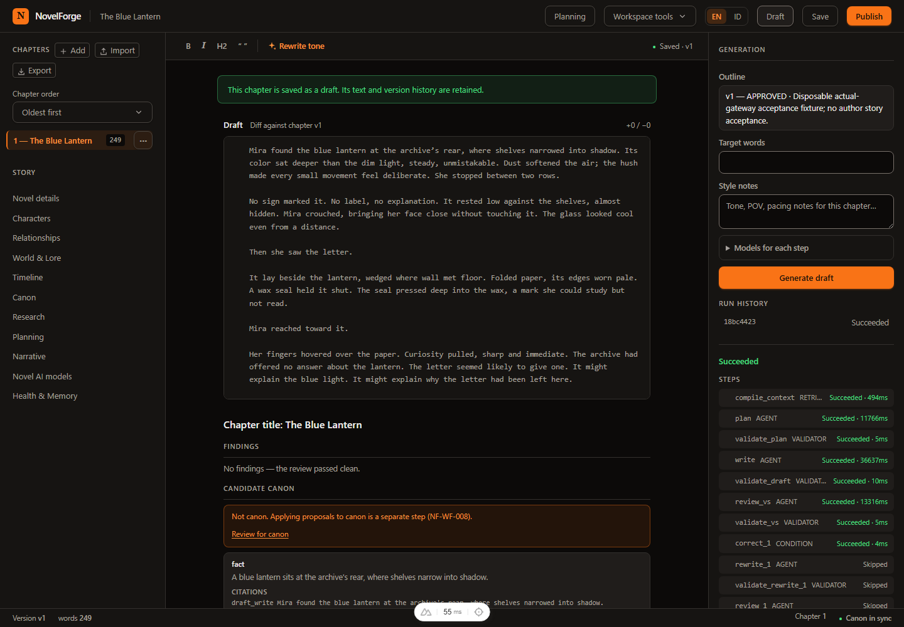
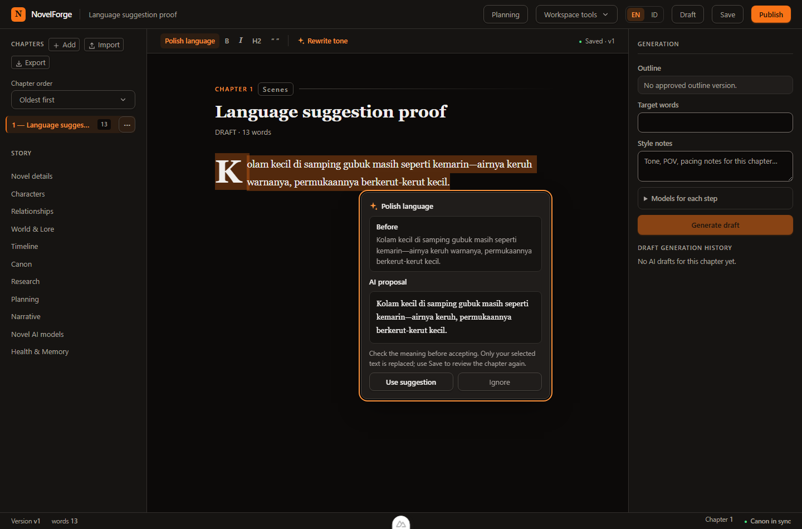
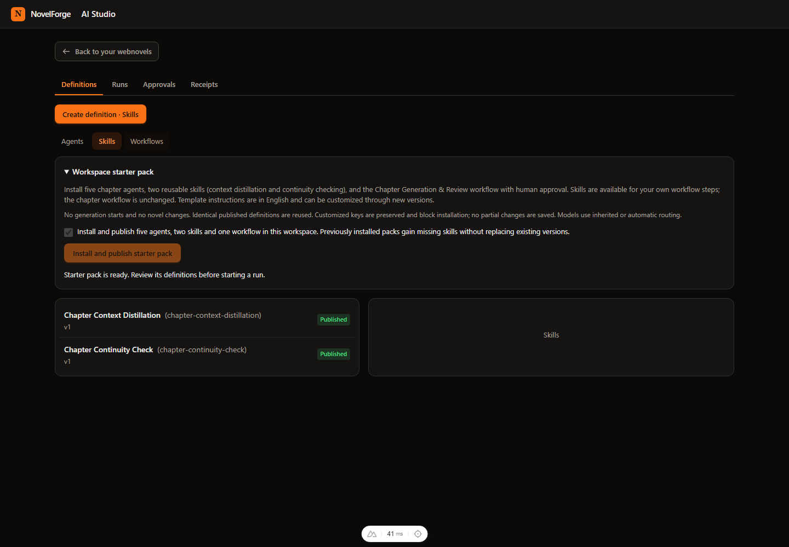
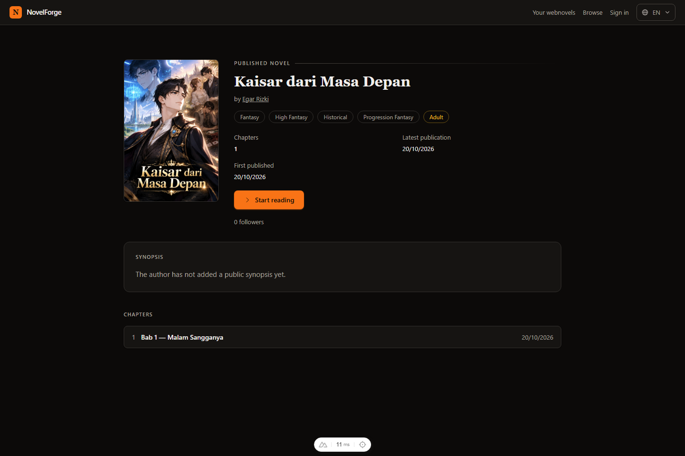
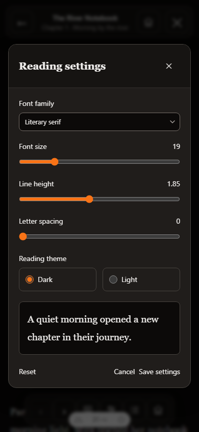

# NovelForge AI

An AI-assisted webnovel authoring platform with structured story knowledge,
chapter workflows, continuity review, recoverable revisions, and a public reader.

> The LLM writes and reasons. NovelForge remembers, validates, versions, and protects the story.

NovelForge targets stories of **2,000–2,500+ chapters**. This is a design goal,
not a production-scale acceptance claim. The UI supports **English and Bahasa Indonesia**.

## Screenshots

Examples from development captures, including demonstration stories and test data.
These illustrate the interface rather than release acceptance; labels and available
models depend on locale and configuration. Click an image to view it at full size.

### Writer workspace and chapter workflow

Write and navigate chapters alongside AI generation, review results and candidate
canon. Saving a chapter, accepting a draft and approving canon are separate actions.

[](docs/screenshots/chapter-workflow.png)

### Author tools

| Language suggestions | AI Studio |
| --- | --- |
| Review the original and proposed wording before using or ignoring a suggestion. | Manage workspace agents, reusable skills and workflows; the starter pack includes context and continuity skills. |
| [](docs/screenshots/language-suggestions.png) | [](docs/screenshots/ai-studio.png) |

### Public novel page

Readers can see the cover, author, genres, publication information and chapter list.
The synopsis area shows an empty state when no public synopsis has been provided.

[](docs/screenshots/novel-details.png)

### Mobile cover and reader controls

| Cover Studio · Bahasa Indonesia | Reading preferences · English |
| --- | --- |
| Choose a generated cover candidate and apply it explicitly. | Adjust font family, font size, line height, letter spacing and reading theme. |
| [](docs/screenshots/cover-studio-mobile.png) | [](docs/screenshots/reader-settings-mobile.png) |

Screenshot provenance is recorded in [docs/screenshots](docs/screenshots/README.md).

## Project status

**Active development — not a general production release.** Updated 2026-10-23.

Implementation, automated verification, live integration, author acceptance and
release approval are tracked separately. Read the [current progress](docs/14-progress/CURRENT.md),
[delivery plan](docs/implementation/DELIVERY-PLAN.md) and
[issues and gaps](docs/implementation/ISSUES-AND-GAPS.md) for actual evidence.
Historical test receipts do not prove a fresh installation on your host.

The additions below are included in this development update. Their bounded
verification does not imply production release approval.

## Features

| Area | Capabilities |
| --- | --- |
| Author workspace | Novel setup wizard, workspace management, rich-text editor, chapter navigation/sorting, create/rename/delete, import/export, active-chapter save/draft, and whole-novel publication. |
| AI chapters | Author instructions and outlines, bounded story context, planning/writing/review workflows, per-step model preferences, structured validation, draft comparison/application and explicit author approval. |
| Story knowledge | Characters and historical states/knowledge, relationships, world/lore, timeline/events, approved canon and candidate proposals. |
| Planning and narrative | Outlines, arcs, planning horizons, Narrative DNA, threads, promises/payoffs, simulation, causality and endgame tooling. |
| Research and memory | Reference library/ingestion, provenance, lexical/vector retrieval, hierarchical memory and rebuildable projections. Embeddings require a compatible configured model. |
| AI Studio | Workspace-scoped agents, skills and workflows, versioned definitions, starter packages, AI-assisted creation, run history, model choices and usage analytics. |
| Cover Studio | Author notes, style choices, batches of 1–9 images, cover selection and history. Supported models/transports depend on gateway configuration. |
| Public reader | Published-novel discovery, novel/chapter pages, search, genre filters, progress, reader library, comments, follows and notifications. |
| Administration | Server-enforced SUPER_ADMIN gateway/model/profile configuration, routing information and audit history. Workspace ownership does not grant platform administration. |
| Recovery | Revisions, checkpoints, branches, impact analysis, non-destructive restore, durable queues and source/version checks. Generation, canon approval and publication remain distinct. |

### Latest development additions

This update includes the following separately tracked additions:

- Character discovery and identity linking; proposed references and clan/organization
  information with author approve/edit/reject controls.
- Internal chapter safeguards for outline authority, consistent context and readable
  language, including custom AI definitions.
- Reader floating controls, reading preferences, chapter search, modal comments,
  public covers/details and a public browse landing page.
- Platform identity settings for product name, logo letters and mark color.
- Cover payload retention controls and additional gateway/catalog support.
- Failed-step retry preserving successful work, settings recovery for failures
  requiring a new run, and brighter text selection.

See [CURRENT.md](docs/14-progress/CURRENT.md) for scope and limitations. AI safeguards
and schema validation do not guarantee factual accuracy, prose quality or consistency.
Generated proposals become canon only through the relevant author decision or an
explicitly authorized policy.

## Architecture

```text
Nuxt web :3001 → same-origin /api proxy → Fastify API :3000
                                            │
                              PostgreSQL 16 + pgvector
                              Redis 7 / BullMQ workers
                                            │
                       Model Manager → Gateway adapter → LLM gateway
```

The TypeScript/pnpm monorepo uses Nuxt/Vue, Fastify, Prisma, PostgreSQL/pgvector
and Redis/BullMQ. The AI boundary is `AIGateway` → `OmniRouteGateway`; a compatible
gateway, such as the author's separately operated akanesia-router, supplies model
services. Model IDs and profile mappings are configuration. The external gateway
enforces quotas; NovelForge records reported generation usage.

## Installation options

| Setup | Application | Databases |
| --- | --- | --- |
| Windows | Native Node.js / pnpm | Existing Docker Desktop services, or fresh dedicated development services |
| Linux | Native Node.js / pnpm | Native PostgreSQL/pgvector and Redis; required path for repository coding agents |
| Docker-assisted development | Native Node.js / pnpm | Selected infrastructure services from `docker-compose.yml` |

**There is no complete application Docker image or all-in-one web/API/worker
Compose deployment in this repository.** Compose runs infrastructure; start the
application processes separately.

### Prerequisites

- Git and **Node.js 24**, the exercised baseline. The manifest declares `>=22`,
  but runtime scripts need `--experimental-transform-types`; use a compatible
  recent runtime rather than an early Node 22 build.
- **pnpm 12.5.1**, pinned in `package.json`.
- PostgreSQL **16** with matching **pgvector**, and Redis **7**.
- A reachable compatible LLM gateway and authorized profile/model mappings for
  AI operations. Text, embedding and image capabilities are separate.
- S3-compatible storage and valid `S3_*` configuration for operations using object
  storage. Compose does not provision storage or the gateway.

Inspect existing services before provisioning. On the author's Windows host,
reuse running Docker services and preserve their credentials/data/volumes. Follow
the [environment preflight](docs/11-deployment/ENVIRONMENT-PREFLIGHT.md) for host
requirements, extension privileges and disposable test database permissions.

### 1. Clone, install and configure

Windows / PowerShell:

```powershell
git clone https://github.com/ch0c01dxyz/NovelForge-AI.git
Set-Location NovelForge-AI
npm install --global pnpm@12.5.1
if (-not (Test-Path .env)) { Copy-Item .env.example .env }
pnpm install --frozen-lockfile
```

Linux / Bash:

```bash
git clone https://github.com/ch0c01dxyz/NovelForge-AI.git
cd NovelForge-AI
npm install --prefix "$HOME/.local/share/novelforge-tools" pnpm@12.5.1
export PATH="$HOME/.local/share/novelforge-tools/node_modules/.bin:$PATH"
test -f .env || cp .env.example .env
pnpm install --frozen-lockfile
```

Install Node using your approved distribution/version manager first. Persist the
Linux tools directory in your shell's PATH if needed. Configure `.env` privately:

| Variable | Required configuration |
| --- | --- |
| `DATABASE_URL` | Actual PostgreSQL host, published port, database and authorized credentials. Native processes use a host address such as `127.0.0.1`, not Compose DNS name `postgres`. |
| `REDIS_URL` | Actual Redis endpoint, such as `redis://127.0.0.1:6379` for fresh local development. |
| `POSTGRES_*`, `REDIS_PORT` | Compose settings; match credentials to `DATABASE_URL`. Editing them does not change credentials in an initialized database volume. |
| `APP_ENCRYPTION_KEY` | Strong private encryption secret. Preserve across restarts/backups; changing it can prevent saved gateway credential decryption. |
| `OMNIROUTE_BASE_URL`, `OMNIROUTE_API_KEY` | Actual gateway endpoint/secret. Persisted gateway and profile settings also require administration setup. |
| `S3_*` | Actual endpoint, bucket, region and credentials. Startup requires nonempty credential settings; placeholders do not provide working storage. |
| `NODE_ENV`, `PORT` | `development` and API port `3000` for this guide. |
| `NUXT_API_BASE` | `http://localhost:3000` for the web server's API proxy. |

The example file uses container-network PostgreSQL/Redis addresses: adjust them
for native processes. Do not assume the example gateway port is running. Keep
`.env`, credentials, backups and private manuscripts/evidence out of Git.
Generate an encryption secret locally and store its output privately:

```bash
node -e "console.log(require('node:crypto').randomBytes(32).toString('hex'))"
```

### 2A. Windows / Docker-assisted infrastructure

On a new Windows host, install/start Docker Desktop with Linux containers and
its WSL2 backend. Reuse healthy existing services instead of recreating them.

```powershell
docker ps
docker compose config --quiet
# Fresh development infrastructure only; omit when reusing existing services.
docker compose up -d --no-deps postgres redis
docker compose ps postgres redis
```

These commands also work for a deliberately chosen Docker-assisted Linux setup
with Docker Engine and the Compose plugin already installed. Linux coding agents
follow native preflight instead of installing Docker.

Compose additionally declares acceptance services and host-specific external
volumes. **Do not use an unqualified `docker compose up -d` on a fresh clone**,
create substitute acceptance volumes, or use the working acceptance database for
disposable tests. Start only `postgres redis` for fresh development. Never use
`docker compose down -v` as an installation/troubleshooting step.

### 2B. Linux native infrastructure

On Ubuntu, inspect versions and package candidates first:

```bash
node --version
pnpm --version
psql --version
redis-server --version
apt-cache policy postgresql-16 postgresql-16-pgvector redis-server
```

An administrator can install missing compatible packages from repositories
appropriate for that Ubuntu release:

```bash
sudo apt-get update
sudo apt-get install -y git curl ca-certificates \
  postgresql-16 postgresql-client-16 postgresql-16-pgvector redis-server
sudo systemctl start postgresql redis-server
```

If these versions are unavailable, follow [native setup guidance](docs/11-deployment/ENVIRONMENT-PREFLIGHT.md).
Other distributions require their native package manager/service names. Create
a dedicated development role/database, set a private password, grant database
ownership and configure `DATABASE_URL`. Arrange pgvector extension privileges;
do not grant superuser on a shared database merely to pass tests.

For a **fresh dedicated local instance**, an administrator can provision the
development database as follows. Skip creation when reusing existing resources:

```bash
sudo -u postgres createuser --pwprompt novelforge
sudo -u postgres createdb --owner=novelforge novelforge
sudo -u postgres psql --dbname=novelforge --command='CREATE EXTENSION IF NOT EXISTS vector;'
redis-cli ping
```

Use the private password entered at the prompt in `DATABASE_URL` (URL-encode
reserved characters). Test database creation/extension permissions are a separate
preflight step; the development role above is not granted cluster-wide administration.

### 3. Generate the database client and apply migrations

From the repository root, after services and `.env` are ready (PowerShell or Bash):

```bash
node --env-file=.env packages/database/node_modules/prisma/build/index.js generate --config packages/database/prisma.config.ts
node --env-file=.env packages/database/node_modules/prisma/build/index.js migrate deploy --config packages/database/prisma.config.ts
```

Back up populated databases and review pending migrations before upgrades.
Never use migration reset or test preparation against working data.

### 4. Start the application

Open three terminals at the repository root:

```bash
# Terminal 1: API
node --env-file=.env --experimental-transform-types apps/api/src/server.ts
```

```bash
# Terminal 2: workflow, memory, publication, notification and cover consumers
node --env-file=.env --experimental-transform-types apps/worker/src/index.ts
```

```bash
# Terminal 3: Nuxt development server
pnpm --filter @novelforge/web dev --dotenv ../../.env --port 3001
```

The worker does not automatically load the root `.env`; keep `--env-file=.env`
or supply variables through your process manager. Nuxt's `--dotenv` explicitly
loads the same root file; `--port 3001` avoids inheriting API `PORT=3000`.
API and worker must share the intended database/Redis configuration.

- Web: <http://localhost:3001>
- API liveness: <http://localhost:3000/health>
- Datastore readiness: <http://localhost:3000/ready>
- Public catalog: <http://localhost:3001/browse>
- Sign in / register: <http://localhost:3001/sign-in>
- Administration: <http://localhost:3001/admin> (SUPER_ADMIN only)

Use one hostname consistently for session cookies. `/ready` checks database and
Redis; it does not certify models, storage, worker progress or production readiness.
The root page opens the public catalog. Use `/author` for the author home;
`/login` is an alias for `/sign-in`.

### 5. First-use setup

1. Register through the sign-in page, then create a workspace and novel through
   the author home. Normal authors may own one workspace with unlimited novels;
   SUPER_ADMIN is exempt from the workspace limit.
2. Have the operator provision the initial trusted SUPER_ADMIN through an
   authorized database administration procedure. Registration does not grant
   this role; there is no universal default admin login.
3. Configure a gateway in administration, synchronize its catalog, enable
   compatible models and map them to Model Profiles. A catalog entry alone does
   not prove enablement, compatibility or successful dispatch.
4. Install/publish the chapter starter package through AI Studio and review model
   choices. Existing installations may already have these definitions.
5. Save story information and approved planning, then generate/review chapters.
   Prose acceptance, canon approval and publication remain separate actions.

## Checks and troubleshooting

```bash
pnpm lint
pnpm typecheck
pnpm test
pnpm -r --filter './apps/*' build
```

Database suites need confirmed disposable databases, extensions and test-role
permissions. Some create/drop their own databases: read the selected suite and
[preflight](docs/11-deployment/ENVIRONMENT-PREFLIGHT.md) before running it.
The `scripts/verify-clone.ps1` / `.sh` helpers contain Compose-specific checks;
this README refresh is not a new Windows/Linux clean-install test receipt.

| Symptom | Check |
| --- | --- |
| Startup refused | Missing environment values, root `.env` not loaded, or unconfigured example endpoints/secrets. |
| Database/Redis unreachable | Host/published ports for native processes; Compose DNS names only inside the corresponding network. |
| `vector` migration fails | Matching pgvector binaries/image and extension privileges on the intended database. |
| Draft stays pending | Workflow consumer running against the same database/Redis as the API; inspect history before starting more workers. |
| Model/profile mismatch | Enabled mappings and per-step/inherited preferences. Repeating an invalid selection does not repair configuration. |
| Gateway limit/connection failure | Recorded attempts and gateway health. Where integrated, use explicit retry; otherwise review settings before another run. |
| Cover/vector search unavailable | Verify image/embedding capabilities and profile mappings separately from chat. |

## Repository and documentation

```text
apps/web/                 Author, reader and administration UI
apps/api/                 Fastify routes and application services
apps/worker/              BullMQ consumers and recovery
packages/                 Shared domain, AI, retrieval and validation
packages/database/        Prisma schema and reviewed migrations
docs/                     Architecture, design, operations and evidence
tasks/                    Implementation and acceptance contracts
```

- [Start here](START-HERE.md) and [operating rules](AGENTS.md)
- [Delivery plan](docs/implementation/DELIVERY-PLAN.md) and [current evidence](docs/14-progress/CURRENT.md)
- [AI orchestration](docs/06-ai/MULTI-LLM-ORCHESTRATION.md) and [evidence policy](docs/06-ai/MODEL-EVIDENCE-POLICY.md)
- [Foundational design](docs/design/writer-workspace/index.html) and [design tokens](docs/design/DESIGN-TOKENS.md)
- [Deployment](docs/11-deployment/DEPLOYMENT.md), [environment preflight](docs/11-deployment/ENVIRONMENT-PREFLIGHT.md), [backup/restore](docs/11-deployment/BACKUP-RESTORE-RUNBOOK.md)
- [Security](docs/09-security/SECURITY.md)

Contributions follow bounded tasks, tenant authorization, recoverable mutations,
focused checks, independent review and updated evidence. Roadmap entries and
model-generated text are not completion evidence.

## License

Copyright © NovelForge contributors. Licensed under the
[Apache License, Version 2.0](LICENSE).
