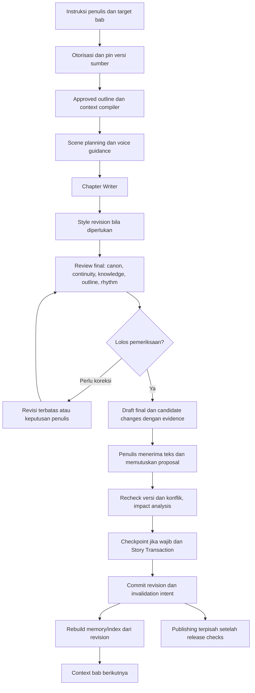

# Analisis workflow awal dan NovelForge V2

> Historical analysis. The author subsequently approved applying its
> recommendations. Active English decisions and execution order now live in
> [ADR-0013](../adr/ADR-0013-workflow-delivery-and-recovery-foundation.md) and
> [DELIVERY-PLAN](DELIVERY-PLAN.md); live technical gaps belong exclusively in
> [ISSUES-AND-GAPS](ISSUES-AND-GAPS.md). Preserve this report as prior analysis,
> not as a competing instruction source.

Tanggal analisis: 30 September 2026.

Status: laporan perbandingan dan rekomendasi, bukan ADR yang telah diterima atau perubahan roadmap. Tidak ada kode aplikasi, migration, atau keputusan arsitektur yang diubah dalam analisis ini.

## 1. Kesimpulan

Pertahankan arsitektur V2, lalu pulihkan keterhubungan alur pengguna yang lebih jelas pada rancangan awal. NovelForge membutuhkan satu siklus penulisan bab yang selesai dari outline sampai memori untuk bab berikutnya, sebelum memperluas simulasi.

`docs_compare` menjelaskan produk writing/publishing dengan pipeline agen yang konkret. `docs` memperkuatnya menjadi platform pengelolaan cerita: canon, state, causality, Planning Horizon, Narrative DNA, simulation, recovery, dan endgame. Perluasan ini sesuai misi proyek, tetapi implementasi yang ada masih berupa sejumlah kemampuan yang belum seluruhnya terhubung ke workflow penulis.

Masalah terpenting bukan jumlah agen atau pilihan framework. Masalahnya adalah context generation yang belum lengkap, approval yang belum dapat dilanjutkan, belum adanya ekstraksi fakta AI dan consolidation otomatis, serta pemulihan lintas-domain yang ditunda.

## 2. Cakupan dan batas bukti

Perbandingan meliputi workflow produk/AI, workflow penulis/pembaca, serta urutan pengembangan. Sumber utama:

- Rancangan awal: [workflow](../../docs_compare/docs/architecture/07-workflows.md), [AI](../../docs_compare/docs/architecture/04-ai.md), [orchestrator](../../docs_compare/docs/specs/03-ai-orchestrator.md), [novel intelligence](../../docs_compare/docs/specs/01-novel-intelligence.md), [reader/publishing](../../docs_compare/docs/specs/04-reader-publishing.md), [UI](../../docs_compare/docs/architecture/08-ui.md), [phases](../../docs_compare/docs/implementation/10-phases.md).
- V2: [core workflows](../07-workflows/CORE-WORKFLOWS.md), [AI orchestration](../06-ai/AI-ORCHESTRATION.md), [roadmap](../12-roadmap/IMPLEMENTATION-ROADMAP.md), [current state](../14-progress/CURRENT.md), dokumen domain, ADR-0006/0008, serta catatan progress dan test matrix yang relevan.
- Pemeriksaan kode terarah: orchestrator, workflow executor/routes, canon retrieval, editor aktif, dan worker.

Ada tiga tingkat bukti: **spesifikasi** menyatakan perilaku yang diinginkan; **catatan implementasi** menyatakan hasil pekerjaan sebelumnya; **kode yang diperiksa** memperlihatkan perilaku pada jalur tertentu. Laporan ini tidak menyamakan ketiganya.

`docs_compare/docs/implementation/12-progress.md` masih menyatakan “Not started”. Jadi folder itu adalah baseline kebutuhan, bukan bukti bahwa fitur lama pernah berfungsi dan kemudian hilang. Pemeriksaan ini statis; tidak menjalankan aplikasi, model, benchmark, atau test suite. Angka pengujian di CURRENT adalah catatan sebelumnya, bukan verifikasi ulang sesi ini. Beberapa entri memakai tanggal Oktober 2026, setelah tanggal sesi; tanggal tersebut perlu direkonsiliasi sebelum dipakai sebagai bukti kronologi.

## 3. Perbandingan rancangan

| Aspek | Workflow awal | V2 | Penilaian |
|---|---|---|---|
| Fokus produk | Menulis, menghasilkan konten, publikasi, pembaca | Memelihara cerita panjang dengan state dan recovery | V2 lebih kuat untuk misi 2.000–2.500+ bab; jalur pengguna tetap harus selesai |
| Pipeline bab | Retrieval → Scene Planner → Character Voice → Writer → Continuity → Lore → Style → Finalizer | Approved outline/state/memory → Planner → Writer → review continuity/knowledge/rhythm → candidate → approval → commit → consolidation | V2 melengkapi siklus perubahan cerita; voice/style/finalization harus tetap punya tanggung jawab jelas |
| Planning authority | Outline di atas synopsis sudah eksplisit | Dipertahankan, ditambah Planning Horizon dan hierarki saga/arc/scene | Bukan inovasi yang baru muncul di V2; V2 memperluas kebutuhan lama |
| Canon | Canon/reference terpisah; kandidat perlu review | Candidate Canon, konflik, otoritas, state/event/causal evidence lebih rinci | Pertahankan V2 |
| Long-form memory | L0–L6, consolidation, larangan full-manuscript scan sudah ada | Tetap ada, dikaitkan dengan source revision dan invalidation | Kebutuhan lama belum selesai hanya karena desain V2 lebih lengkap |
| Karakter/relasi | Bible, voice, state, relationship changes | Historical state, knowledge boundary, directional relationships, bonds | Peningkatan domain; harus masuk context dan reviewer |
| Rhythm/simulation/endgame | Tidak memiliki spesifikasi terpisah sedetail V2 | Kebijakan ritme, konsekuensi, resolusi akhir | Tambahan berguna; modul simulasi opsional sesuai novel |
| Recovery | Versioning entity dan generated content reversible where practical | Revision, change set, checkpoint, branch, restore non-destruktif | Peningkatan keselamatan paling penting, tetapi fondasinya terlalu akhir untuk dependency saat ini |
| Workflow engine | Tujuh node kinds, graph/version/limits/retry/approval | Konsep dipertahankan dan executor generik dibangun | Infrastruktur graph bukan bukti chapter workflow siap digunakan |
| Editor | Tiptap dan inline AI actions eksplisit | Workspace dengan outline, state, evidence, recovery | UI aktif masih editor dasar, belum pengalaman yang dijanjikan |
| Reader/publishing | Lifecycle publikasi, public routes, social, progress | Publishing ada di Phase 13; reader journey tidak dirinci | Ada kebutuhan tanpa pemilik implementasi yang jelas |
| Gateway | Multi-9Router di balik adapter | OmniRoute utama di balik AIGateway | Pertahankan batas adapter; jangan menjadikan penggantian nama alasan rewrite |
| Pengembangan | Fase engine → orchestrator → workflows → reader | Fase domain lebih rinci, task contracts, ADR, review | Disiplin lebih kuat; status harus menunjukkan integrasi pengguna juga |

Catatan penting: synopsis anti-overfitting, hierarchical memory, bounded retry, logical request versus attempt, dan spoiler safety sudah ada pada dokumen awal. Jangan mencatat kebutuhan tersebut sebagai tambahan V2 lalu melupakan hutang implementasinya.

## 4. Pemetaan fase

Nomor fase lama dan baru tidak setara. Pemetaan ini berdasarkan kemampuan, bukan penyetaraan status selesai.

| Fase awal | Padanan V2 |
|---|---|
| 0 Discovery | 0 Repository & Architecture Foundation, dengan discovery sebagai kegiatan awal |
| 1 Foundation | 0–1; sebagian hardening di 13 |
| 2 Novel Engine | 1–2, 6–8, serta sebagian world/simulation di 10 |
| 3 Writer Editor | 2 Writing Core; inline AI masih membutuhkan integrasi |
| 4 Gateway Engine | 3 AI Infrastructure / OmniRoute |
| 5 Knowledge Engine | 5 Retrieval + 6 Story Intelligence |
| 6 Agent Engine | 4 Agent/Skill/Workflow Platform |
| 7 AI Orchestrator | 3–4 dan milestone orchestrator, dengan dependency pada domain lain |
| 8 AI Workflows | 4 untuk executor; 6–9 untuk konteks/review cerita; 11 untuk recovery |
| 9 Reader Platform | Sebagian tujuan publishing di 13; public reader belum memiliki scope/exit lengkap |
| 10 Admin and Evaluation | Tersebar pada 3–4, 13, dan 14 |

Karena itu, “Phase 9 selesai” di V2 tidak berarti Reader Platform selesai. Roadmap V2 sudah menetapkan dirinya sebagai otoritas nomor fase. Gunakan ID kemampuan dan nama milestone ketika membandingkan kedua generasi dokumen.

## 5. Temuan dan solusi

### F1 — Context generation belum mengikuti konteks cerita yang disyaratkan

**Bukti kode:** [orchestrator.ts](../../apps/api/src/services/orchestrator.ts), fungsi `compile`, mengambil `canon.listFacts` dan `retrieval.search`. Input direct generation berisi novel, agent, instruction, contextQuery; tidak memiliki identitas bab/scene/outline/revision. Tidak ada pengambilan otomatis approved outline, state karakter/relasi, timeline, thread/promise, atau DNA pada fungsi itu.

**Dampak:** menyimpan outline dan state belum membuat AI otomatis menggunakan keduanya. Author dapat menyalin konteks ke instruction, tetapi itu tidak memberikan jaminan otoritas, versi, atau kelengkapan yang diminta spesifikasi.

**Solusi:** buat kontrak task penulisan bab yang menunjuk novel, bab/scene, approved outline version, serta basis revision. Compiler mengambil konteks relevan dari service domain yang sudah ada. Pakai compiler yang sama untuk direct chapter generation dan node workflow yang menulis/review bab. Generic generation tetap boleh melayani tugas tanpa bab. Jika belum ada approved outline, arahkan ke perencanaan/approval atau instruksi penulis yang eksplisit dan tercatat; jangan diam-diam mengganti sumber dengan synopsis.

### F2 — Budget context belum sama dengan seleksi relevansi

**Bukti kode:** orchestrator membatasi canon 6.000 karakter, lalu `break` ketika fakta berikutnya melebihi sisa budget. [canon.ts](../../apps/api/src/services/canon.ts), `listFacts` mode AUTHOR, mengambil fakta aktif tanpa `take` dan mengurutkan `createdAt asc`.

**Dampak:** konteks cenderung berisi fakta yang dibuat lebih awal, bukan yang paling relevan dengan bab. Fakta penting bisa tidak masuk. Pembacaan DB tetap tumbuh dengan seluruh fakta aktif novel meskipun prompt dibatasi. Ini pembacaan semua fakta, bukan bukti scan seluruh manuscript; keduanya harus dibedakan.

**Solusi:** pilih berdasarkan cast, lokasi, arc, thread, validitas waktu cerita, dan dependency aturan. Pisahkan hard constraints wajib untuk task dari latar opsional. Batasi query sebelum materialisasi. Jika konteks wajib tidak muat, pecah tugas atau hentikan dengan alasan yang dapat diperiksa. Jangan memotongnya diam-diam. Simpan sumber/version yang dipakai dan alasan omission. Ukur budget total termasuk instructions dan ruang output; dua batas karakter belum membuktikan total token budget aman.

### F3 — Human approval belum merupakan workflow yang bisa selesai

**Bukti kode:** [workflow-runs.ts](../../apps/api/src/services/workflow-runs.ts), cabang `HUMAN_APPROVAL`, menyimpan `AWAITING_APPROVAL` lalu berhenti. Komentar menyatakan belum ada resume. [definition-routes.ts](../../apps/api/src/definition-routes.ts) menyediakan run/list/detail tanpa decision/resume endpoint. Ini juga dicatat dalam CURRENT dan ADR-0006.

**Dampak:** workflow sensitif berhenti pada titik kontrol penulis. Menjalankan ulang dari awal berisiko mengulang biaya/generation dan kelak menggandakan mutation.

**Solusi:** tambahkan approve/reject dan continuation pada run yang sama. Bekukan version workflow/agent/skill/context, rekam actor dan decision, cek capability kembali, lanjutkan hanya step yang belum selesai, serta lindungi repeated request dengan idempotency. Perubahan sumber saat menunggu harus memicu stale check/revalidation. Membuka approval tidak boleh mengulang semua generation sebelumnya.

### F4 — Lingkaran hasil bab menjadi pengetahuan belum terhubung

**Bukti dokumen:** CURRENT menyebut LLM fact extraction belum ada, canon masih diinput author, chapter prose belum searchable, serta L0–L6 belum materialized. Spesifikasi lama dan V2 sama-sama meminta extraction/consolidation.

**Dampak:** bab baru tidak otomatis menghasilkan kandidat fakta, event/state changes, dan memory yang siap dipakai bab berikutnya. Penulis harus mempertahankan dua representasi cerita secara manual.

**Solusi:** mulai satu contracted Canon Extractor dengan input chapter version final dan context snapshot. Output berupa proposal bertipe dan source spans, bukan write langsung. Author dapat menerima teks tetapi menolak proposal canon. Setelah proposal lolos konflik dan approval, commit state lalu enqueue consolidation/indexing dari revision tersebut. Chapter accepted, canon approved, dan chapter published adalah keputusan yang berbeda.

Jangan membuat tujuh sistem storage hanya karena ada L0–L6. L0/L1 dapat berupa context snapshot/run artifact; tingkat lain berupa projection seperlunya dengan source revision yang jelas. L6 dapat memakai retrieval historis dari sumber immutable. Tidak semua tingkat membutuhkan tabel khusus.

### F5 — Recovery ditunda, sementara kemampuan lain sudah bergantung padanya

**Bukti:** [ADR-0008 §4](../adr/ADR-0008-canon-authority.md) sengaja menunda `revision_id` sampai Phase 11. Canon saat ini memakai supersede chain, yang menjaga koreksi fakta tetapi bukan snapshot konsisten lintas-domain. Memory juga ditunda karena belum ada `built_from_revision`. Roadmap menaruh simulation di 10, recovery di 11, tetapi MVP cut line sendiri meminta basic checkpoints.

**Dampak:** menambah perubahan simulasi atau bulk rewrite sebelum fondasi recovery memperluas jumlah state yang belum dapat dipulihkan sebagai satu kesatuan. Accepted deviation dalam ADR tidak membuktikan high-impact mutation sudah memenuhi invariant AGENTS.md.

**Solusi:** tarik subset Phase 11 lebih awal: immutable Revision/Change Set, basis revision untuk generation/projection, checkpoint konsisten, impact analysis, dan restore sebagai revision baru. Tidak perlu sekaligus semantic merge, selective restore, atau branch UI lengkap. High-impact mutation harus ditolak jika checkpoint wajib tidak dapat dibuat. Supersede chain yang sudah ada tetap dipertahankan; migrasi tidak boleh mengarang detail sejarah yang sebelumnya tidak direkam.

### F6 — Editor belum menghubungkan penulis dengan kemampuan backend

**Bukti:** [halaman workspace aktif](../../apps/web/app/pages/workspaces/[workspaceId]/novels/[novelId]/index.vue) menggunakan `textarea`, autosave/version, publish, dan panel informasi bab. Tidak ada inline generation/review/approval pada file tersebut. CURRENT menyebut karakter, relasi, narrative, serta story intelligence masih API-only.

**Dampak:** backend bisa memiliki tabel, rule, dan endpoint yang benar, sementara penulis belum dapat menggunakan siklus kerja dari UI.

**Solusi:** kerjakan satu panel terpadu: approved outline/context → generate → review hasil dan evidence → accept/reject → proposal canon → status consolidation. Tambahkan diff hasil AI terhadap versi manuscript, loading/empty/error, cancel, konflik autosave, dan peringatan stale result. Terapkan hasil hanya dengan base manuscript version yang masih cocok. Rich text/Tiptap tetap kebutuhan awal yang belum dipenuhi; jangan menyebut textarea sebagai Tiptap selesai. Rich text dapat menjadi pekerjaan terpisah dari penyambungan siklus AI.

### F7 — Publishing dan reader kehilangan batas scope yang tegas

**Bukti:** rancangan awal memiliki reader public routes, discovery, reading progress, dan lifecycle DRAFT → IN_REVIEW → SCHEDULED → PUBLISHED. V2 roadmap menyebut publishing di Phase 13, tetapi CURRENT menyebut reader access unphased, tanpa endpoint public chapter atau UI pembaca.

**Dampak:** status PUBLISHED pada sisi penulis tidak berarti novel sudah bisa dibaca publik. Spoiler predicate juga tidak otomatis menyediakan authorization pembaca non-member.

**Solusi:** tentukan submilestone Phase 13 untuk publish/unpublish, pinned published version, public novel/chapter read, navigation, akses non-member, dan spoiler boundary. Basic reader perlu selesai sebelum menyebut platform publishing siap. Bookmark/comment/follow/notification dapat menyusul dengan status eksplisit; dukungan import/export format lama juga harus dipetakan per format, bukan dianggap selesai oleh label baseline.

### F8 — Jalur eksekusi panjang belum durable

**Bukti:** CURRENT menyebut workflow synchronous. [worker.ts](../../apps/worker/src/worker.ts) yang diperiksa membuktikan heartbeat/Redis; belum merupakan executor chapter workflow durable. Direct generation dan workflow memakai transport AI yang sama, tetapi membangun prompt/context melalui jalur berbeda.

**Dampak:** chain agen panjang tetap terikat request. Human approval dan retry setelah restart membutuhkan state lebih kuat daripada heartbeat dan history saja.

**Solusi:** gunakan BullMQ yang sudah terpasang saat chapter pipeline dibuat durable. Persist input, version pins, step output, approval, dan resume position; gunakan job identity stabil, cancel, retry terklasifikasi, serta commit idempotent. Jangan menahan transaksi DB selama panggilan LLM atau menunggu manusia. Catat context sebelum request pertama agar kegagalan/interupsi juga dapat dijelaskan. Hindari engine/orchestrator baru yang menduplikasi executor yang sudah ada.

### F9 — “Fase selesai” terlalu mudah dibaca sebagai “fitur pengguna selesai”

**Bukti:** CURRENT menyatakan 0–9 COMPLETE sambil memuat missing deliverables. Phase 4 memiliki multi-agent test workflow tetapi tidak resume; Phase 6 belum hierarchical memory/extraction; Phase 8/9 belum UI dan belum masuk compiler otomatis. Test matrix berguna untuk komponen, tetapi CURRENT menyebut belum ada automated E2E runner.

**Solusi:** catat per kemampuan: domain/schema, API, workflow integration, UI, recovery, E2E. Bedakan “slice backend selesai” dari “workflow pengguna selesai”. Exit criterion harus memasukkan data melalui jalur author yang nyata dan mengamati hasil akhirnya, bukan hanya seed DB lalu menguji read API. Ini tidak membatalkan hasil tes komponen yang sudah sah; ini menambahkan bukti yang berbeda.

### F10 — Dokumen memerlukan klarifikasi otoritas dan urutan validasi

**Bukti:** CORE-WORKFLOWS menaruh validators sebelum commit, sedangkan SYSTEM-ARCHITECTURE juga menyebut post-commit validators. ADR-0006 masih menggambarkan RETRIEVAL sebagai belum executable, sementara kode dan CURRENT sudah mendukungnya. Catatan lama bisa benar pada waktu dibuat tetapi membingungkan bila dibaca sebagai keadaan sekarang.

**Solusi:** nyatakan validation pemblokir di dalam/sebelum commit, sementara review mahal/advisory dan rebuild boleh sesudah commit. Kegagalan rebuild harus meninggalkan status stale/pending yang jujur, bukan mengklaim memory terkini. Beri ADR lama catatan evolusi bertanggal/rujukan; jangan menulis ulang sejarah. Jadikan docs_compare arsip requirement, dengan requirement mapping ke spec, acceptance, dan status sekarang. Klarifikasi juga perbedaan baseline ADR-001…012 versus file ADR-0001…0012 agar ID pendek tidak ambigu.

## 6. Workflow gabungan yang disarankan

Diagram merupakan alur bisnis; lingkar koreksi harus dibatasi, bukan menambahkan cycle ilegal ke DAG executor. Implementasikan sebagai attempt/revision baru dengan batas percobaan atau node revisi yang terbatas.

Ketentuan handoff:

1. Scene Planner menghasilkan tujuan scene, cast, konflik, informasi yang boleh terungkap, dan outline version.
2. Voice analysis dan style tetap tanggung jawab eksplisit, tetapi tidak wajib menjadi dua panggilan LLM terpisah untuk setiap bab. Gunakan skill atau reviewer sesuai kebutuhan.
3. Review final memeriksa teks setelah edit style terakhir. Edit setelah review membatalkan hasil review yang relevan; pipeline awal berisiko membiarkan Style Editor mengubah fakta setelah Continuity/Lore memeriksa versi sebelumnya.
4. Findings memiliki rule, severity, evidence, affected source/version, dan proposal koreksi. Preferensi rhythm yang soft tidak menjadi larangan otomatis.
5. Extraction dapat dibuat lebih awal sebagai draft, tetapi proposal yang disetujui harus cocok dengan chapter version final. Tidak boleh menyetujui fakta dari teks yang sudah diubah.
6. Finalizer menjadi langkah deterministik untuk memastikan artifact/version/review lengkap; tidak perlu agen baru yang kembali menulis teks setelah validasi.
7. Hasil generation tetap proposal. Tidak otomatis diterapkan ke editor, canon, atau publikasi.
8. State application menggabungkan mutation yang disetujui secara konsisten. Draft manuscript dapat tersimpan lebih dulu; jangan tahan transaksi selama penulis mempertimbangkan proposal.
9. Canonical changes dan durable intent rebuild disimpan atomik. Worker dapat retry tanpa double-apply; projection memiliki source revision dan status fresh/stale/failed yang dapat diperiksa.
10. Bab berikutnya memakai state authoritative dan projection valid. Bila memory belum fresh, tampilkan degraded state atau tunggu; jangan memperlakukan projection lama sebagai kebenaran terbaru.

## 7. Urutan penyelesaian yang disarankan

Ini milestone integrasi, bukan penomoran ulang fase V2. Pekerjaan fondasi yang independen dapat berjalan bersamaan; urutan berikut menunjukkan dependency hasil akhirnya.

| Urutan | Hasil yang harus tersedia | Kriteria selesai |
|---|---|---|
| M0 — Rekonsiliasi kebutuhan | Mapping requirement lama/V2, status backend versus produk, reader scope, proposal ADR untuk penarikan recovery | Semua gap kritis memiliki owner, dependency, dan acceptance; tidak ada klaim full completion yang menutupi workflow terputus |
| M1 — Sumber dan recovery minimum | Basis revision/checkpoint, context compiler bab, version pins, high-impact guard | Outline/current state masuk prompt; fakta wajib tidak hilang diam-diam; stale result ditolak; restore terbatas yang didukung menjaga sejarah |
| M2 — Generate sampai keputusan | Satu chapter workflow, bounded review, durable run, approve/reject/resume, UI review/diff | Penulis dapat menghasilkan dan menerima satu bab; resume tidak mengulang step sukses; unauthorized approval ditolak |
| M3 — Bab menjadi pengetahuan | Contracted extraction, proposal decision, state commit, source revision, consolidation/retrieval | Peristiwa bab N menjadi konteks relevan bab N+1; candidate yang ditolak tidak menjadi canon |
| M4 — Konsistensi penggunaan nyata | Integrasi character/relationship/DNA dan warning evidence dalam alur yang sama | Pelanggaran knowledge/relationship terdeteksi dari teks aktual; preferensi soft tetap advisory |
| M5 — Publikasi minimum | Release checks, public reader, navigation, publish/unpublish/version behavior | Pembaca non-member dapat membaca versi published; draft dan spoiler masa depan tertutup |
| Berikutnya | Simulasi opsional Phase 10, recovery lanjutan Phase 11, endgame Phase 12, hardening/advanced | Dikerjakan di atas siklus penulisan yang sudah teruji; tidak semua tabel blueprint dibuat tanpa kebutuhan |

Tarikan subset recovery ke depan memerlukan ADR yang menjelaskan perubahan terhadap ADR-0008, scope snapshot, migrasi data lama, serta rollback non-destruktif. Human approval/resume juga perlu kontrak transisi yang tegas. Laporan ini mengusulkan perubahan tersebut; belum mengesahkannya.

## 8. Acceptance scenario prioritas

| Skenario | Bukti yang harus dihasilkan |
|---|---|
| Synopsis menyebut perjalanan; approved outline meminta pemulihan cedera | Prompt dan output chapter mengikuti outline dengan batas canon; versi sumber tercatat |
| Fakta penting baru berada setelah ribuan fakta lama | Fakta terpilih berdasarkan relevansi/dependency, bukan urutan pembuatan; query dan context tetap bounded |
| Tokoh belum mengetahui rahasia | Dialogue review memberi finding dengan bukti knowledge boundary dan posisi cerita |
| Style revision menambahkan kejadian baru | Review lama dinyatakan stale; teks final diperiksa ulang |
| Workflow berhenti di approval, server restart, author melanjutkan | Run yang sama berlanjut; output dan usage step sebelumnya tidak diduplikasi |
| Approval dikirim dua kali atau oleh user tanpa capability | Satu decision/commit; akses ilegal ditolak server-side |
| Author mengedit outline/canon/manuscript ketika AI berjalan | Apply mendeteksi base version stale; tidak menimpa hasil kerja penulis |
| Extraction salah menyatakan karakter meninggal | Proposal ditolak; approved canon tetap hidup; penolakan terlacak |
| Bab diterima dan state berubah | Bab berikutnya mengambil fakta/state yang disetujui, bukan mengandalkan copy-paste penulis |
| Checkpoint gagal dibuat sebelum world-rule retcon | Mutation tidak diterapkan |
| Restore checkpoint lama | Revision baru tercipta; sejarah setelah checkpoint tetap dapat diakses; projection lama invalid/stale |
| Rebuild gagal atau job terkirim ulang | Tidak ada double-apply; status pending/failed tampak; retry dari revision yang benar |
| Stream terputus | Artifact INCOMPLETE tidak otomatis masuk manuscript/published |
| Reader membuka draft atau bertanya melampaui bab yang diizinkan | Akses/response dibatasi tanpa membocorkan isi maupun identitas future fact |
| Drama gap melewati preferensi soft | Advisory evidence muncul; cerita tidak dipaksa membuat konflik |
| Novel sintetis 2.500 bab | Instrumentasi membuktikan routine generation tidak membaca semua bab; biaya query/context terukur, bukan diasumsikan dari unit test |

Uji scenario satu siklus melalui UI/API nyata dengan model stub yang deterministik; pisahkan evaluasi kualitas prosa terhadap model riil. Test komponen tetap dipakai. Tidak perlu membangun framework evaluasi baru sebelum alur pertama berfungsi.

## 9. Keputusan yang direkomendasikan

- Gunakan `docs` sebagai baseline arsitektur dan `docs_compare` sebagai daftar requirement historis yang harus ditelusuri nasibnya.
- Pertahankan modular monolith, service boundaries, schema validation, capabilities, database constraints, gateway adapter, serta versioned agent/skill/workflow yang sudah tersedia.
- Dahulukan satu workflow penulis lengkap beserta recovery minimum; jangan menjadikan Phase 10 otomatis pekerjaan berikutnya hanya karena nomor fase.
- Kembalikan voice/style/finalization dan reader journey sebagai tanggung jawab yang dapat diuji; tidak semuanya perlu agent atau subsystem baru.
- Ukur selesai dari kemampuan penulis menghasilkan bab, mengontrol perubahan cerita, dan menggunakan hasilnya pada bab berikutnya secara aman.

Tidak ada persentase completion atau estimasi durasi diberikan karena scope integrasi dan recovery belum mempunyai kontrak yang cukup rinci untuk angka yang dapat dipertanggungjawabkan.
